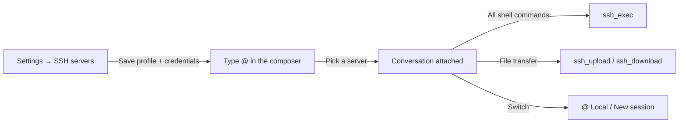

# DSH SSH Manager

> Manage and operate remote servers from DeepSeek Harness chat: type `@`, pick a server, and every command runs there.

[](LICENSE)

[中文](README.md) | **English**

A plugin for [DeepSeek Harness](https://github.com/deepseek-ai/deepseek-harness) (DSH). It stores SSH connections under **Settings → SSH servers** and exposes them in the composer's `@` menu. Once a server is picked, the conversation is attached to it: the agent runs shell commands through `ssh_exec` and moves files with `ssh_upload` / `ssh_download`.

It is built for using DSH as a remote operations assistant: inspect logs, disks, and processes, or deploy services without typing `ssh user@host` again and again.

---

## Features

- **Saved servers**: name, host, port, user, authentication mode (password / private key / SSH agent), key path, key passphrase, ProxyJump, and notes.
- **Connection test**: verify authentication and network in one click; shows the remote hostname, login user, kernel, and latency.
- **Attach with @**: the composer's `@` menu contains a dedicated **SSH servers** section; a pick inserts an atomic reference chip.
- **Command routing**: while attached, `ssh_exec` / `ssh_test` / `ssh_upload` / `ssh_download` default to the attached server, and the system prompt tells the agent to run every shell command through `ssh_exec`.
- **Local bash guard**: while a server is attached, the local `bash` tool is denied with a message to use `ssh_exec`, so commands cannot silently run on the local machine. Local file tools (read/write/glob, …) remain available for preparing uploads and saving downloads.
- **Secret handling**: passwords and key passphrases live only in DSH's credential store. Agent tools never accept or return them, so they never enter the session log.
- **Detach**: pick **Local (no SSH)** from the `@` menu to go back to the local machine; new sessions start local.

## Workflow



## Installation

### Requirements

- **DeepSeek Harness (DSH)** with the Web GUI / Desktop app.
- macOS or Linux with the system OpenSSH (`ssh`, `scp`). Tested with OpenSSH 10.2.
- No npm dependencies: the plugin only uses Node.js built-ins.

### Steps

1. Clone the repository (do not move or delete the directory after installation):

   ```bash
   git clone https://github.com/yuyeyubee/dsh-ssh-manager.git
   ```

2. Install the local bundle in DSH: ask the agent to call `plugin_manager`'s `install_bundle` with the absolute path of the cloned directory, or install a local bundle from DSH's plugin management page and select that directory.

3. Refresh the DSH Web page. After refreshing:

   - **SSH servers** appears under Settings;
   - typing `@` in the composer shows the **SSH servers** section.

> The plugin is installed as a `link:` dependency; the repository directory is the plugin itself. Moving or deleting it breaks the installation and requires reinstalling.

## Usage

### 1. Add a server

Open **Settings → SSH servers** and fill in:

| Field | Description |
| --- | --- |
| Name | For example "Production Web" |
| Host | Domain or IP, for example `192.0.2.10` |
| Port | Defaults to 22 |
| User | Remote login name |
| Authentication | Password / private key / SSH agent |
| Password / passphrase | Required only for password or encrypted-key auth; stored in the local credential store |
| Key file | For example `~/.ssh/id_ed25519`; leave empty to use the agent or SSH config |
| ProxyJump | Optional, for example `user@bastion:2222` |
| Note | Optional |

Click **Test** before saving to confirm the connection works.

### 2. Attach a server in chat

1. Type `@` in the composer.
2. Pick a server from the **SSH servers** section.
3. A reference chip appears in the composer; send the message normally.

From that message on, the agent runs commands on the server through `ssh_exec`; local `bash` is denied.

### 3. Example requests

- "Check disk usage and memory."
- "Upload local `/tmp/app.tar.gz` to `/opt`."
- "Download `/var/log/nginx/error.log` to local `/tmp`."
- "Restart nginx and confirm it is healthy."
- "List the largest directories under `/var/www`."

### 4. Return to the local machine

Type `@` again and pick **Local (no SSH)**. Commands run locally again; new sessions are local by default.

## Tool reference

While a server is attached, the agent can call:

| Tool | Purpose | `server` argument |
| --- | --- | --- |
| `ssh_list_servers` | List saved servers | — |
| `ssh_save_server` | Create or update a server (no secrets) | — |
| `ssh_remove_server` | Delete a server and its credentials | Required |
| `ssh_test` | Test the connection and report remote details | Optional; defaults to the attached server |
| `ssh_exec` | Run a remote shell command; returns exit code, stdout, stderr | Optional; defaults to the attached server |
| `ssh_upload` | Upload a file or directory over SCP | Optional; defaults to the attached server |
| `ssh_download` | Download a file or directory over SCP | Optional; defaults to the attached server |

Each `ssh_exec` call opens a fresh SSH connection and a fresh shell; chain steps with `&&` or use absolute paths.

## Security

- **Config**: `~/.dsh/ssh-manager/servers.json`, mode `0600`, no passwords.
- **Secrets**: stored in DSH's credential store (`~/.dsh/.credentials.yaml`) under
  `ssh-manager/<id>-password` and `ssh-manager/<id>-passphrase`.
- **Session log**: agent tools never accept or return passwords; secrets can only be entered from the Settings page, so they never reach the chat log.
- **Execution**: every operation is an independent OpenSSH call (`/usr/bin/ssh`, `/usr/bin/scp`). Passwords are answered by a transient `SSH_ASKPASS` helper fed from the environment; the helper directory is mode `0700` and removed after the call, so secrets are not written to disk.
- **Host keys**: first connections use `StrictHostKeyChecking=accept-new`, matching normal `ssh` behavior; fingerprints are stored in `~/.ssh/known_hosts`.
- **Local bash guard**: while attached, local `bash` is denied so commands cannot silently run on the local machine.
- **Recommendation**: prefer key authentication. If a password is unavoidable, restrict source IPs, avoid long-term root logins, and rotate the password regularly.

## Data format

Example `~/.dsh/ssh-manager/servers.json` (no secrets):

```json
{
  "version": 1,
  "servers": [
    {
      "id": "srv-1a2b3c4d",
      "name": "Production Web",
      "host": "192.0.2.10",
      "port": 22,
      "username": "deploy",
      "auth": "key",
      "keyPath": "/Users/me/.ssh/id_ed25519",
      "description": "Production",
      "createdAt": "2026-01-01T00:00:00.000Z",
      "updatedAt": "2026-01-01T00:00:00.000Z"
    }
  ]
}
```

## How it works

- **Host** (`index.js`): server config store, credential access, OpenSSH execution, seven agent tools, the `/api/ssh-manager` Settings route, system-prompt sections, and the `bash` guard.
- **Client** (`client.js`): the Settings page (`settings.section`), the `@` menu source, and the inline SSH reference renderer.
- **Attachment state**: a pick serializes to `@[name](dsh-ssh:<id>)` in the user message. The Host reads the last user message containing that mention from the session log, so switching, resuming, or replaying a session keeps the same target without plugin-owned state.
- **Routing**: a system-prompt section states the active target; tools default to it; the local `bash` guard redirects accidental local execution to `ssh_exec`.

## Limitations

- Commands are non-interactive: no TTY programs, no interactive `sudo` (passwordless sudo works), and no OTP/2FA prompts.
- `ProxyJump` bastions should use key or SSH-agent auth; the saved password is used for the primary target.
- One active server per conversation; the last `@` mention wins. In very long sessions, compaction may drop an early mention — mention the server again to re-attach.
- The local `bash` guard is intentional. If you prefer prompt-only guidance instead of a hard block, adjust the guard in `index.js`.
- macOS / Linux system OpenSSH only; Windows is not adapted.
- Built against DSH `0.2.2-rc.1` plugin APIs, which may change across DSH releases.

## Development

```text
dsh-ssh-manager/
├── index.js          # Host: store, SSH/SCP, tools, route, prompt, guard
├── client.js         # Client: Settings page, @ source, inline mention renderer
├── cordis.patch.yml  # Bundle patch
├── locale/           # Plugin-manager title/description (zh, en)
├── icon.svg          # Plugin icon
└── README.md
```

Local checks (no dependencies):

```bash
node --check index.js
node --check client.js
```

Test in DSH after installing:

1. Add a server in Settings and test the connection.
2. Type `@` and pick the server.
3. Run commands, upload, and download in chat.
4. Pick **Local** and confirm local execution is back.

## License

[MIT](LICENSE) © 2026 陈一鸽 (yuyeyubee)
