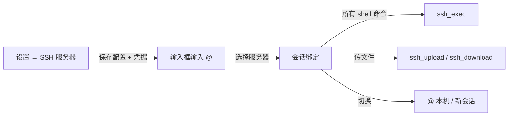

# DSH SSH Manager

> 在 DeepSeek Harness 的对话里管理和操作远程服务器：输入 `@` 选一台服务器，之后的命令都在它上面执行。

[](LICENSE)

**中文** | [English](README.en.md)

一个 [DeepSeek Harness](https://github.com/deepseek-ai/deepseek-harness)（DSH）插件。它在「设置 → SSH 服务器」里保存 SSH 连接，并把保存的服务器接入对话输入框的 `@` 候选菜单。选中服务器后，整个会话就绑定到该服务器，AI 通过 `ssh_exec` 执行命令、通过 `ssh_upload` / `ssh_download` 传输文件。

适合把 DSH 当作远程运维助手：在聊天里直接看日志、查磁盘、看进程、部署服务，而不需要反复手输 `ssh user@host`。

---

## 功能

- **保存服务器**：名称、主机、端口、用户名、认证方式（密码 / 私钥 / SSH Agent）、私钥路径、私钥口令、跳板机（ProxyJump）、备注。
- **测试连接**：一键验证认证与网络，显示远端 hostname、登录用户、内核版本和延迟。
- **@ 绑定**：在输入框输入 `@`，候选菜单里有独立的「SSH 服务器」分组；选中后插入一个原子引用。
- **命令路由**：绑定会话后，`ssh_exec` / `ssh_test` / `ssh_upload` / `ssh_download` 的 `server` 参数可以省略，默认使用当前绑定的服务器；系统提示词同时要求 AI 用 `ssh_exec` 执行所有 shell 命令。
- **本地 bash 守卫**：绑定服务器期间，本地 `bash` 工具会被拒绝，并提示改用 `ssh_exec`，避免命令误跑到本机；本地文件工具（read/write/glob 等）仍然可用，方便准备上传或保存下载。
- **安全凭据**：密码和私钥口令只保存在 DSH 的凭据存储里，AI 工具不接收也不返回它们，不会写入会话日志。
- **本机切换**：`@` 菜单中的「本机（不使用 SSH）」可随时断开；新会话默认也在本机。

## 工作流



## 安装

### 前置条件

- 已安装 **DeepSeek Harness（DSH）**，并使用 Web GUI / Desktop 版。
- macOS 或 Linux，系统自带 OpenSSH（`ssh`、`scp`）。已在 OpenSSH 10.2 验证。
- 无需安装任何 npm 依赖：插件只使用 Node.js 内置模块。

### 安装步骤

1. 克隆仓库到本地（安装后请勿移动或删除该目录）：

   ```bash
   git clone https://github.com/yuyeyubee/dsh-ssh-manager.git
   ```

2. 在 DSH 中安装本地 bundle：让 Agent 调用 `plugin_manager` 的 `install_bundle`，参数为上面克隆目录的绝对路径；或在 DSH 的插件管理页面安装本地 bundle 并选择该目录。

3. 刷新 DSH 的 Web 页面。刷新后：

   - 「设置」里出现 **SSH 服务器** 页面；
   - 输入框输入 `@` 时出现 **SSH 服务器** 分组。

> 插件以 `link:` 方式安装，仓库目录就是插件本体。移动或删除目录会导致插件失效，需要重新安装。

## 使用方法

### 1. 添加服务器

打开 **设置 → SSH 服务器**，填写：

| 字段 | 说明 |
| --- | --- |
| 名称 | 例如「生产 Web」 |
| 主机 | 域名或 IP，例如 `192.0.2.10` |
| 端口 | 默认 22 |
| 用户名 | 远端登录用户 |
| 认证方式 | 密码 / 私钥 / SSH Agent |
| 密码 / 私钥口令 | 仅密码或私钥认证需要；保存在本机凭据存储 |
| 私钥文件 | 例如 `~/.ssh/id_ed25519`，可留空使用 agent 或 SSH 配置 |
| 跳板机 | 可选，格式 `user@bastion:2222` |
| 备注 | 可选 |

保存前可以点「测试」确认能连上。

### 2. 在对话中绑定服务器

1. 在输入框输入 `@`；
2. 在候选菜单的 **SSH 服务器** 分组里选择一台；
3. 输入框出现对应引用，正常发送消息。

从这条消息开始，AI 会通过 `ssh_exec` 在该服务器上执行命令；本地 `bash` 会被拒绝。

### 3. 常用说法

- 「看一下磁盘占用和内存」
- 「把本地 `/tmp/app.tar.gz` 传到 `/opt`」
- 「下载 `/var/log/nginx/error.log` 到本机 `/tmp`」
- 「重启 nginx 并确认状态」
- 「列一下 `/var/www` 下最大的几个目录」

### 4. 回到本机

再次输入 `@`，选择「本机（不使用 SSH）」。之后命令恢复在本机执行；新建会话默认也是本机。

## 工具参考

绑定服务器后，AI 可以直接调用以下工具：

| 工具 | 作用 | `server` 参数 |
| --- | --- | --- |
| `ssh_list_servers` | 列出已保存的服务器 | — |
| `ssh_save_server` | 新增或更新服务器（不含密码） | — |
| `ssh_remove_server` | 删除服务器及其凭据 | 必填 |
| `ssh_test` | 测试连接、返回远端信息与延迟 | 可省略，默认当前绑定 |
| `ssh_exec` | 执行远端 shell 命令，返回退出码 / stdout / stderr | 可省略，默认当前绑定 |
| `ssh_upload` | SCP 上传文件或目录 | 可省略，默认当前绑定 |
| `ssh_download` | SCP 下载文件或目录 | 可省略，默认当前绑定 |

`ssh_exec` 每次调用都是一条新的 SSH 连接、一个新的 shell；多条命令请用 `&&` 串联，或使用绝对路径。

## 安全设计

- **配置文件**：`~/.dsh/ssh-manager/servers.json`，权限 `0600`，不含密码。
- **密码 / 口令**：保存在 DSH 凭据存储（`~/.dsh/.credentials.yaml`）中，记录键为
  `ssh-manager/<id>-password` 和 `ssh-manager/<id>-passphrase`。
- **会话日志**：AI 工具不接收、不返回密码；密码只能在设置页面填写，因此不会进入会话记录。
- **执行方式**：每次操作都是一次独立的 OpenSSH 调用（`/usr/bin/ssh`、`/usr/bin/scp`）。密码通过一次性的 `SSH_ASKPASS` 脚本从环境变量读取，脚本目录权限 `0700`，操作结束后立即删除，密码不落盘。
- **主机指纹**：首次连接使用 `StrictHostKeyChecking=accept-new`，与系统 `ssh` 的行为一致；指纹保存在 `~/.ssh/known_hosts`。
- **本地 bash 守卫**：绑定服务器期间拒绝本地 `bash`，避免命令误执行在本机。
- **建议**：优先使用密钥认证；如果必须用密码，建议限制来源 IP、避免长期使用 root 直连，并定期轮换密码。

## 数据格式

`~/.dsh/ssh-manager/servers.json` 示例（不含任何密钥）：

```json
{
  "version": 1,
  "servers": [
    {
      "id": "srv-1a2b3c4d",
      "name": "生产 Web",
      "host": "192.0.2.10",
      "port": 22,
      "username": "deploy",
      "auth": "key",
      "keyPath": "/Users/me/.ssh/id_ed25519",
      "description": "生产环境",
      "createdAt": "2026-01-01T00:00:00.000Z",
      "updatedAt": "2026-01-01T00:00:00.000Z"
    }
  ]
}
```

## 工作原理

- **Host 端**（`index.js`）：服务器配置存储、凭据读写、OpenSSH 调用、7 个 Agent 工具、`/api/ssh-manager` 设置路由、系统提示词、`bash` 守卫。
- **Client 端**（`client.js`）：设置页面（`settings.section`）、`@` 菜单数据源、发送消息中的 SSH 引用渲染。
- **绑定关系**：选中的服务器会序列化为规范引用 `@[服务器名](dsh-ssh:<id>)` 进入用户消息。Host 从会话日志中读取最后一条包含该引用的用户消息，得到当前服务器；因此切换会话、恢复会话、重放都不会丢失绑定，也不需要插件自己维护状态。
- **命令路由**：系统提示词注入当前目标，工具默认使用该目标；本地 `bash` 被守卫拒绝并提示改用 `ssh_exec`。

## 已知限制

- 每条命令都是非交互式执行：不支持需要 TTY 的程序、交互式 `sudo`（可配置免密 sudo）和二次验证（OTP/2FA）。
- `ProxyJump` 跳板机建议使用密钥或 SSH Agent；保存的密码认证用于主目标。
- 同一会话同一时间只有一个活动服务器，最后一条 `@` 引用生效；长时间会话发生上下文压缩后，早期引用可能被压缩掉，重新 `@` 一次即可。
- 绑定期间本地 `bash` 会被拒绝，这是有意设计；如只需要提示词约束、不需要硬拦截，可以修改 `index.js` 中的守卫。
- 仅支持 macOS / Linux 的系统 OpenSSH；Windows 未适配。
- 针对 DSH `0.2.2-rc.1` 的插件 API 开发，DSH 升级后接口可能变化。

## 开发

```text
dsh-ssh-manager/
├── index.js          # Host：存储、SSH/SCP、工具、路由、提示词、守卫
├── client.js         # Client：设置页、@ 菜单、会话内引用渲染
├── cordis.patch.yml  # Bundle patch
├── locale/           # 插件管理页标题/描述（zh、en）
├── icon.svg          # 插件图标
└── README.md
```

本地校验（无需依赖）：

```bash
node --check index.js
node --check client.js
```

安装后在 DSH 中测试：

1. 设置页添加服务器并测试连接；
2. 输入 `@` 选择服务器；
3. 在对话中执行命令、上传、下载；
4. 选择「本机」确认恢复本地执行。

## License

[MIT](LICENSE) © 2026 陈一鸽 (yuyeyubee)
